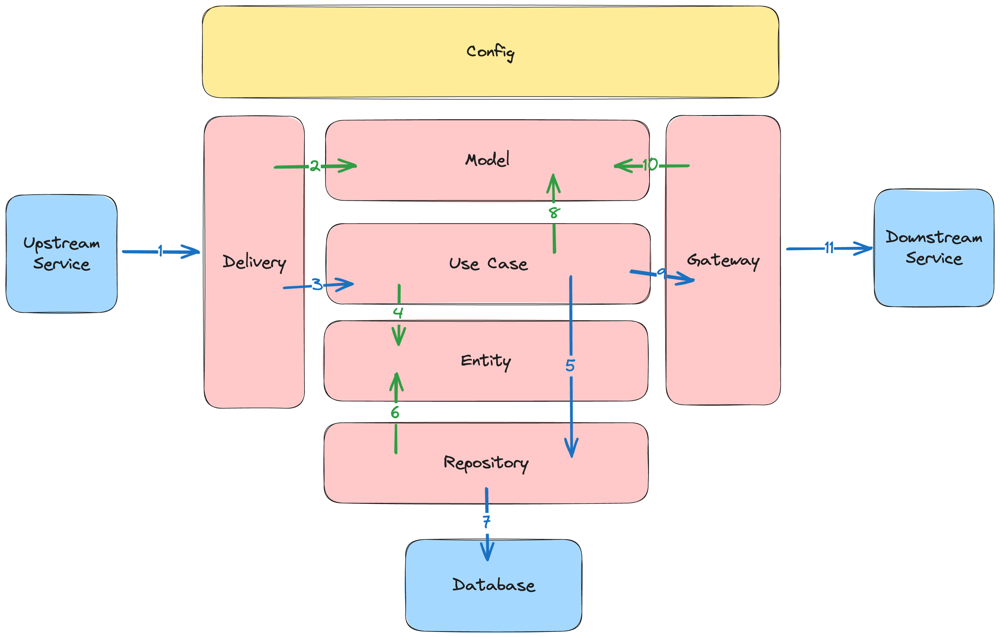

# Golang Clean Architecture

Template backend Go yang siap produksi sekaligus menjadi bahan belajar
arsitektur. Setiap package, tipe, dan fungsi punya komentar dokumentasi
(godoc) berbahasa Indonesia yang menjelaskan **apa** dan **mengapa**. Baca
dengan `go doc ./internal/usecase` atau lewat hover di editor.

Domain contohnya sederhana (user → kontak → alamat), tetapi dipakai untuk
mendemokan semua aspek backend: autentikasi, otorisasi, transaksi, event,
observability, testing, dan deployment.

## Isi

- [Arsitektur](#arsitektur)
- [Menjalankan](#menjalankan)
- [Konfigurasi](#konfigurasi)
- [Keamanan](#keamanan)
- [Event dan outbox](#event-dan-outbox)
- [Observability](#observability)
- [Fitur opsional](#fitur-opsional)
- [Testing](#testing)
- [Migrasi database](#migrasi-database)
- [Menambah fitur baru](#menambah-fitur-baru)

## Arsitektur



Aturan dependency selalu mengarah ke dalam:

```
delivery (HTTP, gRPC, Kafka)  →  use case  →  port (interface)  ←  repository / gateway
```

1. **Delivery** (`internal/delivery`) menerima input dari luar (request HTTP,
   RPC gRPC, pesan Kafka), mengubahnya menjadi model request, lalu memanggil use case.
2. **Use case** (`internal/usecase`) berisi aturan bisnis: validasi, transaksi,
   kepemilikan data, audit, dan penerbitan event. Use case tidak mengenal
   HTTP, gRPC, Fiber, maupun GORM. Ia hanya bergantung pada **port**
   (interface di `internal/usecase/ports.go`).
3. **Repository** (`internal/repository`) mengimplementasikan port akses data
   dengan GORM. **Gateway** (`internal/gateway`) mengimplementasikan port ke
   sistem luar: cache Redis, object storage S3, dan email SMTP.
4. **Config** (`internal/config`) adalah *composition root*: semua dependency
   dirangkai manual di sini, tanpa DI container, supaya alurnya mudah dibaca.

Error domain memakai `internal/apperror` (kode netral protokol seperti
`NOT_FOUND` dan `CONFLICT`). HTTP menerjemahkannya ke RFC 9457 Problem
Details, gRPC ke `codes.Code`.

### Peta folder

| Folder | Isi |
|---|---|
| `cmd/web` | API HTTP + gRPC (opsional) + server admin |
| `cmd/worker` | Outbox relay, consumer Kafka, scheduler, server admin |
| `cmd/cli` | Perintah administrasi (`create-admin`) |
| `api/` | Kontrak API: `openapi.yaml` dan file proto gRPC |
| `db/migrations` | Migrasi SQL (golang-migrate) |
| `internal/apperror` | Error domain bertipe |
| `internal/config` | Konfigurasi bertipe dan wiring dependency |
| `internal/delivery/http` | Controller Fiber, middleware, route, Problem Details, Swagger |
| `internal/delivery/grpc` | Server gRPC, interceptor, `pb/` (kode hasil generate) |
| `internal/delivery/messaging` | Registry handler event, consumer Kafka, retry/DLQ |
| `internal/delivery/admin` | Health check dan `/metrics` (port terpisah) |
| `internal/entity` | Struct tabel database |
| `internal/model` | Request/response API dan event |
| `internal/usecase` | Logika bisnis dan port |
| `internal/repository` | Akses data (GORM) dan transactor |
| `internal/gateway` | Redis cache, S3 storage, SMTP email |
| `internal/outbox` | Relay transactional outbox |
| `internal/scheduler` | Job terjadwal (cron) |
| `internal/security` | Hash password, JWT, refresh token |
| `internal/observability` | Log terstruktur, metrik, helper tracing |
| `test/` | Integration test (testcontainers) |

## Menjalankan

Kebutuhan: Go 1.27.3 dan Docker.

### Mode minimal (hanya MySQL)

```bash
docker compose up -d --build          # atau: make compose-up
```

- API: <http://localhost:3000/api/v1>
- Swagger UI: <http://localhost:3000/docs>
- Health dan metrik: <http://localhost:9090/health/ready>, <http://localhost:9090/metrics>
  (worker: port 9091)

Bila MySQL lokal sudah memakai port 3306, jalankan dengan `MYSQL_PORT=3307 docker compose up -d`.

### Mode lengkap

```bash
make compose-full
# = APP_ENV_FILE=deploy/full.env docker compose --profile full up -d --build
```

Mode ini menambah Kafka, Redis, S3 (SeaweedFS), Mailpit (<http://localhost:8025>),
Jaeger (<http://localhost:16686>), dan Prometheus (<http://localhost:9095>),
serta gRPC di port 50051.

### Tanpa Docker untuk aplikasi

Siapkan MySQL, jalankan migrasi, lalu:

```bash
go run ./cmd/web       # make run-web
go run ./cmd/worker    # make run-worker
```

### Admin pertama

```bash
go run ./cmd/cli create-admin --email admin@example.com   # make create-admin EMAIL=...
```

User harus sudah terdaftar lewat `POST /api/v1/users`.

### Pengguna Windows

`make` bisa dijalankan dari Git Bash atau WSL. Di PowerShell, pakai perintah
aslinya yang tercantum di setiap target `Makefile` (misalnya
`go test ./internal/...`).

## Konfigurasi

Nilai default non-rahasia ada di `config.json`. **Setiap key bisa ditimpa
environment variable** berprefix `APP_`, dengan titik diganti garis bawah:

| Key | Env | Keterangan |
|---|---|---|
| `app.env` | `APP_APP_ENV` | `development` atau `production` |
| `database.password` | `APP_DATABASE_PASSWORD` | Secret: isi lewat env |
| `jwt.secret` | `APP_JWT_SECRET` | Secret, wajib ≥ 32 byte di production |
| `kafka.enabled` | `APP_KAFKA_ENABLED` | Default `false` |
| `redis.enabled` | `APP_REDIS_ENABLED` | Default `false` |
| `storage.enabled` | `APP_STORAGE_ENABLED` | Default `false` |
| `email.enabled` | `APP_EMAIL_ENABLED` | Default `false` |
| `otel.enabled` | `APP_OTEL_ENABLED` | Default `false` |
| `grpc.enabled` | `APP_GRPC_ENABLED` | Default `false` |
| `docs.enabled` | `APP_DOCS_ENABLED` | Wajib `false` di production |

Lihat `.env.example` dan `internal/config/config.go` untuk daftar lengkapnya.
Saat `app.env=production`, aplikasi **menolak start** bila JWT secret masih
default atau terlalu pendek, CORS berisi `*`, atau Swagger UI aktif. Image
Docker default berjalan sebagai production, jadi secret wajib diisi.

## Keamanan

- **Password:** bcrypt, panjang 8–72 byte (72 adalah batas bcrypt).
- **Access token:** JWT HS256, umur 15 menit, dikirim sebagai
  `Authorization: Bearer <token>`. Verifikasi mewajibkan algoritma HS256,
  issuer, audience, dan masa berlaku.
- **Refresh token:** string acak 256-bit, disimpan hanya sebagai hash SHA-256,
  umur 7 hari. Token **dirotasi** setiap kali dipakai. Bila token lama dipakai
  lagi (indikasi pencurian), **seluruh sesi dari login itu dicabut**. Dua
  refresh bersamaan dengan token yang sama tidak pernah menghasilkan dua sesi
  valid (row lock `SELECT … FOR UPDATE`).
- **Trade-off yang disengaja:** logout dan ganti password langsung mencabut
  refresh token, tetapi **access token yang sudah terbit tetap berlaku sampai
  kedaluwarsa** (maksimal 15 menit). Verifikasi JWT tanpa database jauh lebih
  murah. Bila butuh pencabutan instan, tambahkan denylist `jti` di Redis.
- **Login:** pesan error sama untuk email tidak terdaftar dan password salah,
  dan waktu responsnya disamakan (bcrypt dummy).
- **Rate limit:** global 100/menit per IP. Login dan registrasi punya tiga
  limiter: 5/menit per IP+email, 20/menit per IP, dan 10 kegagalan/menit per
  email dari IP mana pun (hanya kegagalan yang dihitung, supaya pemilik akun
  tidak mudah dikunci penyerang). Dengan Redis aktif, batasnya berlaku lintas instance.
  gRPC punya rate limit per IP sendiri (di memori, per instance). Rate limit
  di aplikasi tidak menggantikan perlindungan di edge (WAF, load balancer,
  CDN) untuk serangan terdistribusi dari banyak IP.
- **IP client di belakang proxy:** isi `server.trusted_proxies` dengan IP load
  balancer. Proxy harus **menambahkan** (append) IP client ke
  `X-Forwarded-For`. Tanpa trusted proxy, header itu diabaikan.
- **RBAC:** role `user` dan `admin` (di dalam token). Endpoint `/api/v1/admin/*`
  hanya untuk admin. Kepemilikan data selalu dicek: kontak user lain
  dilaporkan 404.
- **Header dan batas:** helmet, CORS allowlist, timeout request 10 detik,
  body JSON maksimal 1 MB, dan hanya `application/json` (atau multipart untuk upload).
- **Data sensitif:** password, hash, dan token tidak pernah masuk log, audit,
  event, atau span tracing. Nilai query SQL dan perintah Redis tidak direkam
  di trace, dan filter pencarian di URL disamarkan.
- **Port admin terpisah:** `/metrics` dan health check ada di port 9090/9091.
  Jangan buka port ini ke internet.

## Event dan outbox

```
use case ──(1 transaksi)──▶ tabel bisnis + outbox_events
                                   │
                         relay (worker, satu leader)
                     ┌─────────────┴─────────────┐
               Kafka aktif                  Kafka mati
             Kafka → consumer            handler lokal
                     └─────────────┬─────────────┘
                     registry handler (idempoten)
```

- **Transactional outbox:** event ditulis ke `outbox_events` di transaksi yang
  sama dengan perubahan data, jadi tidak pernah ada data tanpa event atau
  event tanpa data.
- **Relay** di worker memakai MySQL `GET_LOCK`, sehingga hanya satu replica
  yang aktif. Urutan event per entity terjaga: bila satu event gagal, event
  berikutnya untuk entity yang sama menunggu.
- **At-least-once:** event bisa terkirim lebih dari sekali. Registry handler
  mencatat `(consumer, event_id)` di `processed_events`, jadi duplikat dilewati.
- **Retry dan DLQ (Kafka):** handler dicoba hingga 1 + 3 kali dengan backoff
  eksponensial. Setelah itu pesan dipindah ke topik `<topik>.dlq` dengan header
  `x-error`, `x-original-topic`, dan `x-attempts`.
- **Event yang diparkir:** setelah gagal kirim sebanyak `outbox.max_attempts`
  (default 10), status event menjadi `failed`, terlihat di metrik
  `outbox_failed`, dan menahan event lain untuk entity yang sama. Setelah
  penyebabnya diperbaiki, pulihkan dengan:

  ```sql
  UPDATE outbox_events SET status = 'pending', attempts = 0 WHERE status = 'failed';
  ```

- **Mode minimal:** tanpa Kafka, relay memanggil handler langsung di worker,
  sehingga fitur seperti email selamat datang tetap berjalan.

## Observability

- **Log:** `log/slog`, JSON di production. Setiap baris memuat `request_id`,
  `user_id`, `trace_id`, dan `span_id` dari context.
- **Metrik Prometheus** (port admin): `http_requests_total`,
  `http_request_duration_seconds` (label template route), metrik gRPC,
  `outbox_pending`, `outbox_failed`, `outbox_published_total`,
  `messages_processed_total`, `messages_dlq_total`, statistik pool DB, dan runtime Go.
- **Tracing OpenTelemetry** (OTLP gRPC, TLS secara default): HTTP, gRPC,
  query DB, Redis, dan diteruskan lewat event outbox sampai consumer.
  Aktifkan dengan `otel.enabled`.

## Fitur opsional

| Fitur | Saat aktif | Saat mati |
|---|---|---|
| Kafka | Event dikirim ke Kafka | Event diproses handler lokal di worker |
| Redis | Cache kontak, rate limit bersama, lock scheduler | Tanpa cache, limiter di memori, scheduler tanpa lock (asumsi satu worker) |
| Storage S3 | `PUT /users/_current/avatar`, `avatar_url` presigned | Route avatar tidak ada |
| Email SMTP | Email selamat datang terkirim | Hanya dicatat di log |
| OpenTelemetry | Span dikirim ke collector | Tidak ada span |
| gRPC | `ContactService` di port 50051 | Tidak di-listen |
| Swagger UI | `/docs` dan `/openapi.yaml` | Tidak ada |

Storage memakai client S3 generik, jadi bisa diarahkan ke AWS S3, Cloudflare
R2, MinIO, atau SeaweedFS (dipakai di docker-compose dan test).

## Testing

```bash
make test               # unit test use case (mock dari mockery)
make test-integration   # integration test, butuh Docker (testcontainers)
make lint               # golangci-lint
make vuln               # govulncheck
```

- Unit test ada di sebelah kodenya (`internal/**/_test.go`).
- Integration test (`test/`, build tag `integration`) menjalankan aplikasi
  utuh terhadap MySQL, Redis, Kafka, S3, dan Mailpit di container. Setiap test
  independen. Set `GCA_TEST_LOG=1` untuk melihat log aplikasi.
- Generate ulang mock: `make mocks`. Generate ulang kode gRPC: `make proto`.
- CI (GitHub Actions) menjalankan lint, unit test dengan race detector,
  integration test, govulncheck, dan build Docker.

## Migrasi database

```bash
make migrate-up
make migrate-create NAME=create_table_orders
```

> **Peringatan:** jangan pernah mengubah file migrasi yang sudah diterapkan di
> sistem yang berjalan. Buat migrasi baru. Migrasi di repo ini ditulis ulang
> sekali karena template belum pernah di-deploy.

## Menambah fitur baru

Contoh: menambah entity "order".

1. Buat migrasi di `db/migrations` (`make migrate-create NAME=create_orders`).
2. Tambah entity di `internal/entity` dan model request/response di `internal/model`.
3. Tambah port repository di `internal/usecase/ports.go`, lalu implementasinya
   di `internal/repository` (embed `Repository[T]`).
4. Tulis use case di `internal/usecase`: validasi, `tx.WithinTransaction`,
   audit, dan `publish` event. Tulis unit test dengan mock (`make mocks`).
5. Tambah controller di `internal/delivery/http` dan daftarkan route di
   `internal/delivery/http/route`.
6. Rangkai di `internal/config/web.go`.
7. Dokumentasikan endpoint di `api/openapi.yaml` (test akan gagal bila lupa).
8. Tulis integration test di `test/`.
9. Bila perlu reaksi asinkron, daftarkan handler event di `registerHandlers`
   (`internal/config/worker.go`).
